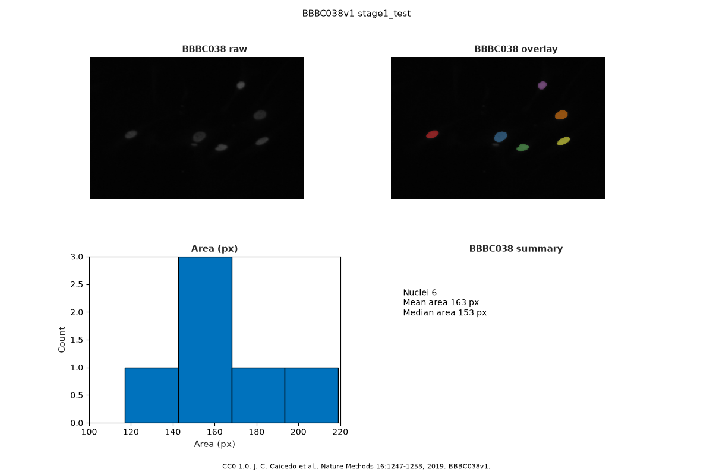

# Acceptance evidence: Epic #1023 (I-E4 labeloverlay and lab-meeting tiledlayout)

**Epic:** [#1023](https://github.com/superche/openmatlab/issues/1023)  
**Milestone:** [BBBC038 nuclei image vertical (M16)](https://github.com/superche/openmatlab/milestone/16) · [`docs/milestones/M16-bbbc038-vertical.md`](../milestones/M16-bbbc038-vertical.md)  
**Design:** [`docs/design/EPIC-1023-labeloverlay.md`](../design/EPIC-1023-labeloverlay.md)  
**Captured:** 2026-10-23  
**Functional tip:** recorded in the follow-up docs commit on this branch (re-run the commands on that commit or on a descendant)  
**Rule:** Outputs below come from real local commands. None are invented.

## Verdict

**Ready for user acceptance.** M16 criterion V06 is **met**. Epic #1023 stays **open** until the user accepts it. Epics #1020–#1022 and #1024–#1025 stay open. This epic does not start I-E5.

`labeloverlay` paints the six I-E3 labels onto the FOV. The lab figure is a 2×2 `tiledlayout`: the raw FOV, the overlay, the area histogram, and a count/mean/median summary. The footnote cites CC0 1.0, Caicedo et al. Nature Methods 2019, and BBBC038v1. The story closes that figure so the 1-by-2 panel stays current.

Citation: J. C. Caicedo et al., Nature Methods 16:1247–1253, 2019. doi:10.1038/s41592-019-0612-7. BBBC038v1. CC0 1.0. The zip and the FOV PNG are not committed.

## 中文摘要

同一张 I-E3 掩膜上，`labeloverlay` 以默认透明度 0.5 把 6 个标号画到原图上。组会图是 2×2：原 FOV、叠加、面积直方图（`Area (px)` / `Count`），以及核数 6、平均 163 px、中位数 153 px。脚注是 CC0 1.0、Caicedo 等 Nature Methods 2019、BBBC038v1。故事画完这幅图后关掉它，当前图仍是 1×2 前后对照，另一幅仍是 `BBBC038 areas`。审阅快照是 [`EPIC-1023-v06.png`](EPIC-1023-v06.png)（12×8 英寸、100 dpi），不是 300 dpi 导出。V06 记为 met（6/10）。Epic #1020–#1025 保持打开。未开始 #1024。

## Functional demo (real CLI output)

```text
$ openmatlab -e "run('demos/bbbc038/story_stage1_test.m')"
BBBC038 V01 zip=/workspace/downloads/bbbc038/stage1_test.zip bytes=9545388
BBBC038 V02 image=/workspace/downloads/bbbc038/fov/0114f484a16c152baa2d82fdd43740880a762c93f436c8988ac461c5c9dbe7d5.png size=256 256 3 class=uint8
BBBC038 V03 level=0.0862745098 P=50 fg=1003 open=978 class=logical
BBBC038 V04 count=6 objects=6
BBBC038 V04 id=1 area=152 cx=50.1382 cy=139.6645 ecc=0.753797
BBBC038 V04 id=2 area=219 cx=131.3516 cy=143.8630 ecc=0.720512
BBBC038 V04 id=3 area=143 cx=158.0140 cy=163.5455 ecc=0.658999
BBBC038 V04 id=4 area=117 cx=181.3419 cy=51.0342 ecc=0.758051
BBBC038 V04 id=5 area=193 cx=204.0622 cy=104.6943 ecc=0.627474
BBBC038 V04 id=6 area=154 cx=206.6818 cy=151.7013 ecc=0.841869
BBBC038 V05 mean=163.0000 median=153.0000 ecc=0.726784
BBBC038 V06 grid=2 2 tiles=4 class=uint8
BBBC038 V06 footnote=CC0 1.0. J. C. Caicedo et al., Nature Methods 16:1247-1253, 2019. BBBC038v1.
```

The V01–V05 lines are unchanged. `class=uint8` is the overlay. The review snapshot below is the same `lab_figure.m` layout, saved at 12 by 8 inches and 100 dpi. It is a rendered figure, not the Broad PNG.



## Measurable gate: pytest

```text
$ python3 -m pytest tests/unit/test_labeloverlay.py tests/bdd/test_bbbc038_labeloverlay_bdd.py tests/conformance/test_m16_v06.py --tb=no -o addopts= -q --disable-warnings
7 passed in 3.25s
```

New cases: `tests/unit/test_labeloverlay.py` (4), `tests/bdd/test_bbbc038_labeloverlay_bdd.py` (2), `tests/conformance/test_m16_v06.py` (1). The conformance test checks the overlay against the documented blend, the footnote, and the 2×2 titles, then checks that the story still leaves the 1-by-2 panel current and the area histogram as the only other figure.

**Existing tests changed: none.** The V03 and V04 conformance tests still pass on this story.

## Feature map

```text
$ openmatlab features | grep labeloverlay
libs.labeloverlay                libs       partial  labeloverlay for one gray or RGB image
```

`partial`: gray or RGB, uint8 or floating, `Transparency` only, eight fixed colors. `Colormap` and `IncludedLabels` stay out.

## Residuals

No new residual. PNG/PDF export at 300 dpi is [#1024](https://github.com/superche/openmatlab/issues/1024). The Workbench recording is [#1025](https://github.com/superche/openmatlab/issues/1025).

## Milestone progress (M16)

- Criteria met: **6 / 10** (V01–V06)
- Conformance: V06 passing (`tests/conformance/test_m16_v06.py`). V07–V10 have no scripts yet (epics #1024–#1025).
- Next: I-E5 #1024. Nothing in this epic calls `exportgraphics` or writes a 300 dpi PNG or PDF.

## CI

Required check name is `test` (`.github/workflows/ci.yml`, `pytest -m "unit or bdd"`). These commands were run locally before that check. The PR does not merge until `test` is green.
