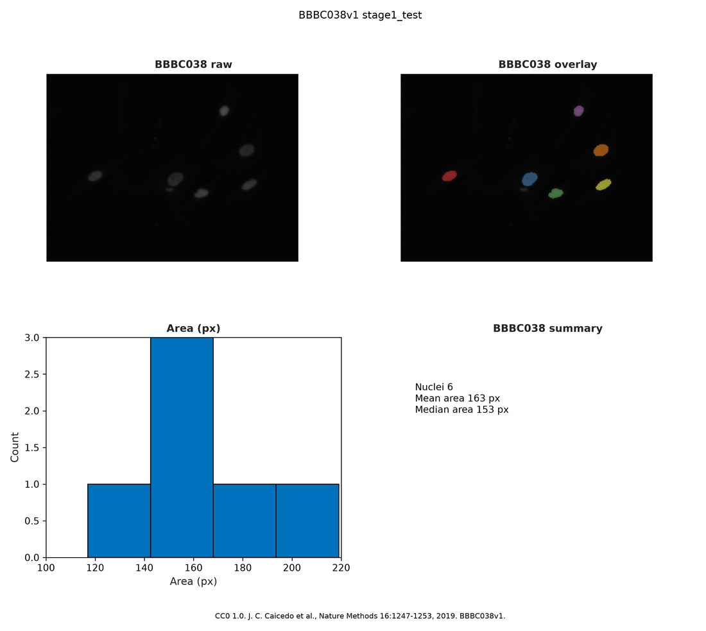

# Acceptance evidence: Epic #1024 (I-E5 PNG and PDF export)

**Epic:** [#1024](https://github.com/superche/openmatlab/issues/1024)  
**Milestone:** [BBBC038 nuclei image vertical (M16)](https://github.com/superche/openmatlab/milestone/16) · [`docs/milestones/M16-bbbc038-vertical.md`](../milestones/M16-bbbc038-vertical.md)  
**Design:** [`docs/design/EPIC-1024-bbbc038-export.md`](../design/EPIC-1024-bbbc038-export.md)  
**Captured:** 2026-10-23  
**Functional tip:** recorded in the follow-up docs commit on this branch (re-run the commands on that commit or on a descendant)  
**Rule:** Outputs below come from real local commands. None are invented.

## Verdict

**Ready for user acceptance.** M16 criterion V07 is **met**. Epic #1024 stays **open** until the user accepts it. Epics #1020–#1023 and #1025 stay open. This epic does not start I-E6.

The 2×2 lab figure is exported at 300 dpi to PNG and PDF before it is closed. The files are non-empty and gitignored. The crop keeps the layout title and the CC0 / Caicedo 2019 / BBBC038v1 footnote. The 1-by-2 panel stays current.

Citation: J. C. Caicedo et al., Nature Methods 16:1247–1253, 2019. doi:10.1038/s41592-019-0612-7. BBBC038v1. CC0 1.0. The zip, the FOV PNG, and the 300 dpi exports are not committed.

## 中文摘要

同一张组会图在关闭前以 300 dpi 导出为 PNG 和 PDF。PNG 258791 字节，3159×2824 像素；PDF 114842 字节，页面约 10.53×9.41 英寸。标题 `BBBC038v1 stage1_test` 和脚注（CC0 1.0、Caicedo 等 Nature Methods 2019、BBBC038v1）留在裁切之内，脚注在面板下方。默认分辨率仍是 150 dpi。文件在 `demos/bbbc038/out/`，不入库。V01–V06 的打印行不变。V07 记为 met（7/10）。Epic #1020–#1025 保持打开。未开始 #1025。

## Functional demo (real CLI output)

```text
$ openmatlab -e "run('demos/bbbc038/story_stage1_test.m')"
BBBC038 V01 zip=/workspace/downloads/bbbc038/stage1_test.zip bytes=9545388
BBBC038 V02 image=/workspace/downloads/bbbc038/fov/0114f484a16c152baa2d82fdd43740880a762c93f436c8988ac461c5c9dbe7d5.png size=256 256 3 class=uint8
BBBC038 V03 level=0.0862745098 P=50 fg=1003 open=978 class=logical
BBBC038 V04 count=6 objects=6
BBBC038 V04 id=1 area=152 cx=50.1382 cy=139.6645 ecc=0.753797
BBBC038 V04 id=2 area=219 cx=131.3516 cy=143.8630 ecc=0.720512
BBBC038 V04 id=3 area=143 cx=158.0140 cy=163.5455 ecc=0.658999
BBBC038 V04 id=4 area=117 cx=181.3419 cy=51.0342 ecc=0.758051
BBBC038 V04 id=5 area=193 cx=204.0622 cy=104.6943 ecc=0.627474
BBBC038 V04 id=6 area=154 cx=206.6818 cy=151.7013 ecc=0.841869
BBBC038 V05 mean=163.0000 median=153.0000 ecc=0.726784
BBBC038 V06 grid=2 2 tiles=4 class=uint8
BBBC038 V06 footnote=CC0 1.0. J. C. Caicedo et al., Nature Methods 16:1247-1253, 2019. BBBC038v1.
BBBC038 V07 png=/workspace/demos/bbbc038/out/story_stage1_test.png pdf=/workspace/demos/bbbc038/out/story_stage1_test.pdf dpi=300 png_bytes=258791 pdf_bytes=114842
```

The V01–V06 lines are unchanged. The PNG is 3159 by 2824 pixels. The PDF page is 10.53 by 9.41 inches. Pixel size over page size is about 300 dpi. The review image below is that export scaled down so the crop can be checked in the repository. It is not the 300 dpi file and not the Broad FOV.



## Measurable gate: pytest

```text
$ python3 -m pytest tests/unit/test_bbbc038_export.py tests/bdd/test_bbbc038_export_bdd.py tests/conformance/test_m16_v07.py --tb=no -o addopts= -q --disable-warnings
5 passed in 9.27s
```

New cases: `tests/unit/test_bbbc038_export.py` (3), `tests/bdd/test_bbbc038_export_bdd.py` (1), `tests/conformance/test_m16_v07.py` (1). The conformance test checks the file sizes, the 300 dpi page, the footnote gap, and that the story still leaves the 1-by-2 panel current.

**Existing tests changed: none.** The V03, V04, and V06 conformance tests still pass on this story.

## Feature map

```text
$ openmatlab features | grep bbbc038_export
libs.bbbc038_export              libs       partial  BBBC038 lab figure PNG and PDF at 300 dpi
```

`partial`: this story's 300 dpi PNG and PDF. `export_fig`, animation, and pixel-identical glyphs stay out.

## Residuals

No new residual. The Workbench recording and the acceptance package are [#1025](https://github.com/superche/openmatlab/issues/1025).

## Milestone progress (M16)

- Criteria met: **7 / 10** (V01–V07)
- Conformance: V07 passing (`tests/conformance/test_m16_v07.py`). V08–V10 have no scripts yet (epic #1025).
- Next: I-E6 #1025. Nothing in this epic records the Workbench.

## CI

Required check name is `test` (`.github/workflows/ci.yml`, `pytest -m "unit or bdd"`). These commands were run locally before that check. The PR does not merge until `test` is green.
